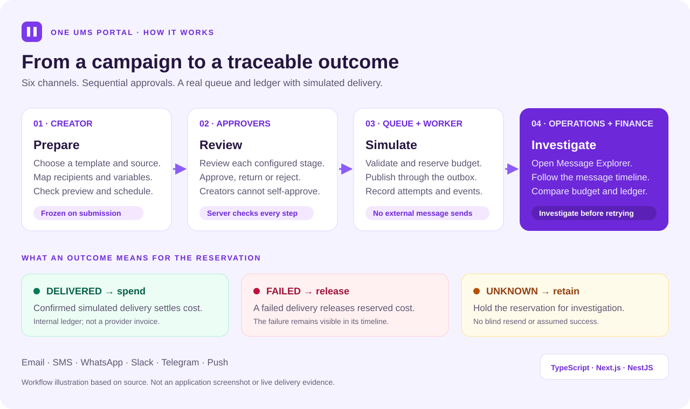
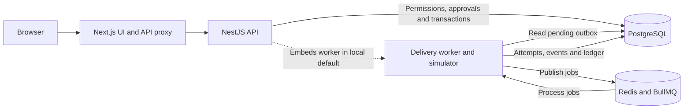

# One UMS Portal

A Unified Messaging System for campaign delivery, sequential approvals, operational investigation, and cost-centre budgets. Built with TypeScript, Next.js, NestJS, PostgreSQL, and Redis/BullMQ.

The interface follows a purple enterprise workspace: grouped navigation, light/dark/system themes, compact tables, message investigation drawers, and separate operations and finance views. The application supports Bahasa Indonesia and English, including navigation, forms, operational notifications and an in-app user guide. User-authored content stays in its original language.

**Default delivery is simulated.** Email, SMS, WhatsApp, Slack, Telegram and Push exercise the real queue and financial ledger without sending external messages. This is an ongoing portfolio project; real provider transport, invoice matching, and visual workflow publication are not implemented yet.



*Source-based workflow illustration, not an application screenshot. Delivery statuses describe the local simulator.*

[Take the tour](#a-campaign-in-four-steps) · [Run locally](#development-setup) · [Browse screens](#screens) · [Install on a server](#server-installation--instalasi-server) · [Read the boundaries](#boundaries)

## A campaign in four steps

| Step | What you do | What the system records |
| --- | --- | --- |
| **1. Prepare** | As creator, select a source, template and channels; map recipients/variables and inspect previews. | Submission freezes the campaign snapshot and approval policy. |
| **2. Review** | Separate eligible users review each configured approval stage. Return for revision when needed. | Versioned decisions and audit evidence; creators cannot approve their own submissions. |
| **3. Simulate** | Complete approvals and the budget/dispatch checks for an immediate or scheduled run. | Budget reservation, PostgreSQL outbox, BullMQ jobs, attempts and simulated events. |
| **4. Investigate** | Follow a message in Message Explorer; compare operations with finance. | Delivered messages spend reserved cost; failures release it; unknown outcomes retain it for investigation. |

The six channels use the same campaign/approval/reporting path. A simulated delivery
does not prove that a real provider accepted or delivered a message. Reservations,
internal spending estimates and provider invoices remain separate concepts.

<details>
<summary><strong>Try it yourself: a local demo with separate roles</strong></summary>

After [development setup](#development-setup), use the synthetic demo company:

1. Sign in as `creator@demo.local`. Choose a seeded template/source, check the
   recipient mapping and preview, then submit a small immediate campaign.
2. Sign out and sign in as `approver@demo.local` to review the first stage. Inspect
   the frozen submission before approving it.
3. Sign in as `finance@demo.local` for the second stage. Final approval runs budget
   and dispatch preflight checks; services must stay running for queue processing.
4. Open **Message Explorer** to inspect the message timeline, then **Cost allocation**
   (`/finance/allocation`) and **Usage & costs** (`/finance/usage`) to compare
   reservations and spending.
5. Find a seeded **UNKNOWN** outcome. It stays unconfirmed and retains its reservation
   until explicitly investigated; the system does not blindly send it again.

Initial demo password: `LocalDemo123!`, unless `DEMO_PASSWORD` was set before the
first seed. These are synthetic local accounts; never seed them into a real tenant
database. Sign-in shortcuts are optional and require
`NEXT_PUBLIC_DEMO_ACCOUNTS=true` at web build time; normal sign-in works without them.

</details>

<details>
<summary><strong>Under the hood: browser, API, queue and ledger</strong></summary>



PostgreSQL holds authoritative campaign, approval, budget, outbox and audit records.
Redis/BullMQ processes delivery jobs. The simulator records outcomes and updates the
internal ledger; real provider transport remains unfinished. The default local API
starts the workers; the server guides also support a separate worker process.

Trace this diagram in the [frontend proxy](apps/web/app/api/%5B...path%5D/route.ts),
[API startup](apps/api/src/main.ts), [campaign approvals/reservations](apps/api/src/campaigns.ts),
[outbox and delivery worker](apps/api/src/queue.ts), and
[standalone worker entry point](apps/api/src/worker.ts).

</details>

## Features

- Company/team isolation and server permissions, cookie sessions, password changes, audit records, profile pictures.
- CSV/XLSX/JSON data, versioned templates, mapped variables and previews, incoming idempotent data APIs, manual authenticated HTTPS retrieval.
- Configurable sequential approvals, no self-approval, frozen submissions, return/revision/reapproval, stale-review protection.
- Immediate, one-time and recurring schedules; missed-run decisions, pause/cancel and interrupted-run recovery.
- Real PostgreSQL outbox and Redis/BullMQ processing, durable message/attempt/event timelines and uncertain-outcome reconciliation.
- Exact-decimal budget reservations, releases, spending, topups and ledger exports; monthly/quarterly/half-year/year periods.
- Message Explorer with server filters and cursor pagination; masked recipients and restricted/audited payload access.
- Operational dashboard, observed channel metrics, internal vendor usage, saved personal widgets and layouts.
- Versioned vendor definitions/accounts and encrypted credentials. Generic HTTP mapping configuration exists; actual generic sending/callbacks remain unfinished and real-account activation is rejected.

## Campaign recipients and provider management

- Campaign variables follow the selected immutable template bodies. Template cards show their parameter names/count and previews; inline template creation is available. Shared parameter names share a column mapping.
- Choose a source dataset/API/upload and explicitly map each channel's recipient column, or select direct input for one recipient and enter the destination/parameter values. Source rows are preserved as a scoped immutable dataset. Supported destination shapes: email address, Indonesian SMS/WhatsApp phone, Slack channel/user ID, Telegram chat ID/@channel, provider Push registration token/alias.
- Email, SMS, WhatsApp, Slack, Telegram and Push are supported in the **simulated** campaign/approval/queue/reporting path. Customer Push is separate from internal device notifications. No live Slack/Telegram/FCM/Meta credentials or vendor delivery have been verified.
- Provider forms appear above lists. Configure integration endpoint/method/auth, JSON headers/body, response ID path and template-based request previews. Use placeholders such as `{{recipient}}`, `{{body}}`, `{{parameters}}` or `{{variables.loan_no}}`; secret headers reference `{{credential.apiKey}}` and values belong in encrypted account credentials. Validate and publish a definition before creating accounts; create a new configuration version for changes.
- Accounts include a sender, optional per-channel sender IDs, From/reply-to, workspace/app/WABA/phone-number IDs and encrypted API/bot/webhook/custom credentials. Partial credential rotation retains other keys; clearing is explicit. Saved secrets are never returned by list APIs. Generic HTTP transport remains disabled until a verified vendor adapter is implemented.
- Rate cards are per account/channel and effective date, with recognized ISO currencies and an explicit FX-to-IDR value for non-IDR quotes. The immutable rate ID/FX identifies the quote used; budget reservations/spending remain IDR. This is not an automatic FX feed or vendor invoice matching.

For this demonstration, login shortcuts list creator/approver/finance/admin/viewer for two seeded demo companies. To enable them in a portfolio build, set `NEXT_PUBLIC_DEMO_ACCOUNTS=true` in `apps/web/.env.local` or the web build environment, then rebuild/restart. Deployment builds remain opt-in and bootstrap never creates demonstration users automatically. `pnpm demo:examples` adds idempotent synthetic examples with 0/1/2/3 parameters to existing demo companies; `pnpm db:setup` includes them on development setup. Do not run demonstration seeding on a real tenant database.

[Scope and remaining boundaries](docs/campaign-integrations-plan.md) · [Verification evidence](docs/campaign-integrations-verification.md)

## Company governance and workspace updates

- **Change history** records company releases, issue fixes, enhancements, deployment references and status transitions. Company admins register records; registration does not deploy code. Saved details are corrected with a new linked record.
- **Maintenance** is company-specific. Standard users cannot sign in/use operational APIs; administrators retain access to turn it off. Queued/scheduled dispatch and incoming datasets wait. Already-started work may finish; expired schedules still require explicit rescheduling.
- **Access & audit** supports 10/30/50/100 rows, dates, menu/use case, exact action, search and semantic/database event filters. Pages retain the search time cutoff; refresh includes newer activity. Metadata capture records changed field names and allowed before/after values, never passwords, API secrets or full message/recipient data. The API now returns an items/total/page/limit/snapshot envelope.
- **User management** displays corporate ID, employee ID, work details and explicit role levels. Role levels are organizational metadata; permissions and approval memberships remain explicit. Company/team assignments are validated server-side.
- Sidebar width supports mouse/keyboard resizing; the persistent workspace keeps sidebar scroll on menu navigation. Login uses a restrained, empty-by-default form; demo shortcuts require NEXT_PUBLIC_DEMO_ACCOUNTS=true at build time.
- Creator provenance is recorded in application metadata, About and [AUTHORS.md](AUTHORS.md), without tracking or hidden access.

[Implementation scope](docs/governance-experience-plan.md) · [Verification evidence](docs/governance-verification.md) · [Login source references](docs/login-design-references.md)

## Server installation / Instalasi server

- **[Step-by-step English guide](docs/deployment-en.md)** — Docker/Compose, migrations, first operator, HTTPS, backups, upgrades, optional Web Push and Kubernetes.
- **[Panduan Bahasa Indonesia](docs/deployment-id.md)** — langkah instalasi server, migrasi DB, admin platform, HTTPS, backup dan Kubernetes.
- **[Credits / Inspirasi dan dependensi](CREDITS.md)** — Novu, Courier, Brevo, Dub, Trigger.dev and implementation libraries.
- **[Product use-case review and priorities](docs/product-review.md)** — available behaviour, gaps and recommended next features.

The same source runs on a workstation or a server. Deployment examples include an API, independent worker, frontend and persistent PostgreSQL/Redis. Secrets and the public origin are configured at runtime. `db:migrate` upgrades schema without seeding demonstrations; `db:bootstrap` creates the first platform operator. See the guides before running these on a server.

New in this increment: role-separated **Companies** onboarding, saved account language, accessible dropdowns, a searchable **Help** page and opt-in **Device notifications**. Device notifications are disabled until an operator configures VAPID/HTTPS. They cover operational team notifications; customer Push campaigns currently use the simulator.

## Development setup

Requires Node.js 24+ and pnpm 11.25.0.

```sh
pnpm install --frozen-lockfile
```

Copy `.env.example` to `.env` to override local configuration. With Docker installed, use `docker compose up -d` for PostgreSQL, Redis and optional Mailpit. Mailpit's interface is at http://127.0.0.1:8025; its SMTP adapter is not wired yet.

Without Docker, keep separate terminals open:

1. `pnpm infra:local` — native PostgreSQL on port 54329, persisted under `.data/postgres`.
2. `pnpm infra:prepare-redis` — one-time checksum-verified Redis core build; requires make and a C compiler. Alternatively supply `REDIS_BINARY`.
3. `pnpm infra:redis` — Redis on port 63799 with AOF, a 256 MB ceiling, and no eviction.
4. `pnpm db:setup` — apply migrations and seed synthetic demo data.
5. `pnpm dev` — frontend at http://127.0.0.1:3000 and API at http://127.0.0.1:4100.

For a compiled local run, stop development, run `pnpm build`, then `pnpm start`. Both modes share Next's build directory.

### Demo accounts

Use `creator@demo.local`, `approver@demo.local`, `finance@demo.local`, `admin@demo.local`, or `viewer@demo.local`. Initial password: `LocalDemo123!`. Set `DEMO_PASSWORD` before the first seed to change it. Seeding does not overwrite existing passwords. A second isolated company uses matching accounts at `other.local`.

Create and submit a campaign as creator, approve the first stage as approver and the second as finance, then investigate its simulated results in Message Explorer. Synthetic contacts intentionally include delivered, failed and uncertain outcomes. Unknown acceptance retains the reservation and does not blindly resend.

Local schedules require the computer and services to stay running. Expired unstarted work becomes missed; replay/rescheduling and interrupted-run recovery require explicit decisions.

## Screens

| Route                                       | Purpose                                                                         |
| ------------------------------------------- | ------------------------------------------------------------------------------- |
| `/dashboard`                                | Logical-message KPIs, volume, channel performance, exceptions, personal widgets |
| `/messages`                                 | Cursor-paginated message search and investigation drawer                        |
| `/deliveries`                               | Queue and uncertain-state investigation                                         |
| `/channels`                                 | Observed channel metrics, explicit simulator/no-observation labels              |
| `/workflows`, `/approvals`                  | Existing campaign definitions and sequential approval workflows                 |
| `/templates`, `/sources`                    | Template versions, imports, incoming/REST connections                           |
| `/finance/usage`                            | Internal estimates and ledger spend by vendor/channel/team                      |
| `/finance/allocation`                       | Cost-centre budgets, topups, ledger/export                                      |
| `/finance/reconciliation`                   | Unconfirmed local outcomes; provider invoice matching is unavailable            |
| `/updates`, `/settings/maintenance`, `/about` | Company change history, admin maintenance controls and application provenance |
| `/settings/companies`                       | Platform-only company onboarding; company admins cannot create other tenants    |
| `/settings/notifications`, `/help`          | Device push preferences/history and bilingual user manual                       |
| `/settings/providers`                       | Vendor configurations, encrypted accounts, rates                                |
| `/settings/applications`, `/settings/audit` | Company administration, approvals, profile and audit                            |

Latest checks and limits: [experience verification](docs/experience-verification.md).

## Verify

```sh
pnpm typecheck
pnpm test
pnpm build
PLAYWRIGHT_BROWSERS_PATH=.runtime/browsers pnpm exec playwright install chromium
PLAYWRIGHT_BROWSERS_PATH=.runtime/browsers pnpm test:e2e
pnpm benchmark
```

Integration tests require migrated PostgreSQL and Redis. Stop the application before running them to avoid competing workers. Browser tests and benchmark require the application running and use synthetic local records. The 10k benchmark consumes simulated budget, never real money.

The dashboard counts logical messages separately from attempts. Delivery rate is confirmed deliveries divided by all requests in the selected creation period, including processing/unknown. Financial estimates, internal ledger spending, provider reports and invoices are distinct. Missing vendor data is not displayed as zero or healthy.

See [verification evidence](docs/verification.md), [UI implementation and limitations](docs/ui-implementation.md), [design specification](docs/ui-ux-specification.md), and the original [product brief](project.md). Local continuation records and browser traces stay outside Git. Repo-local development skills remain in `.agents/skills`.

## Boundaries

Default local development uses no paid SaaS. Actual provider traffic or future hosting may have separate costs. No deployment or real vendor sends are configured. Keep environment files, databases, runtime downloads and encryption keys out of Git; production requires separate secrets and operations setup. Review upstream licenses before redistribution/deployment.

Remaining product work includes real generic/provider transport and authenticated callbacks, dynamic recurring data/REST pagination, richer import diagnostics, full account recovery/editing, WhatsApp vendor-template metadata, advanced workflow orchestration and invoice reconciliation, and broader restart/timezone exercises. Do not infer production capacity or accessibility certification from targeted local checks.
