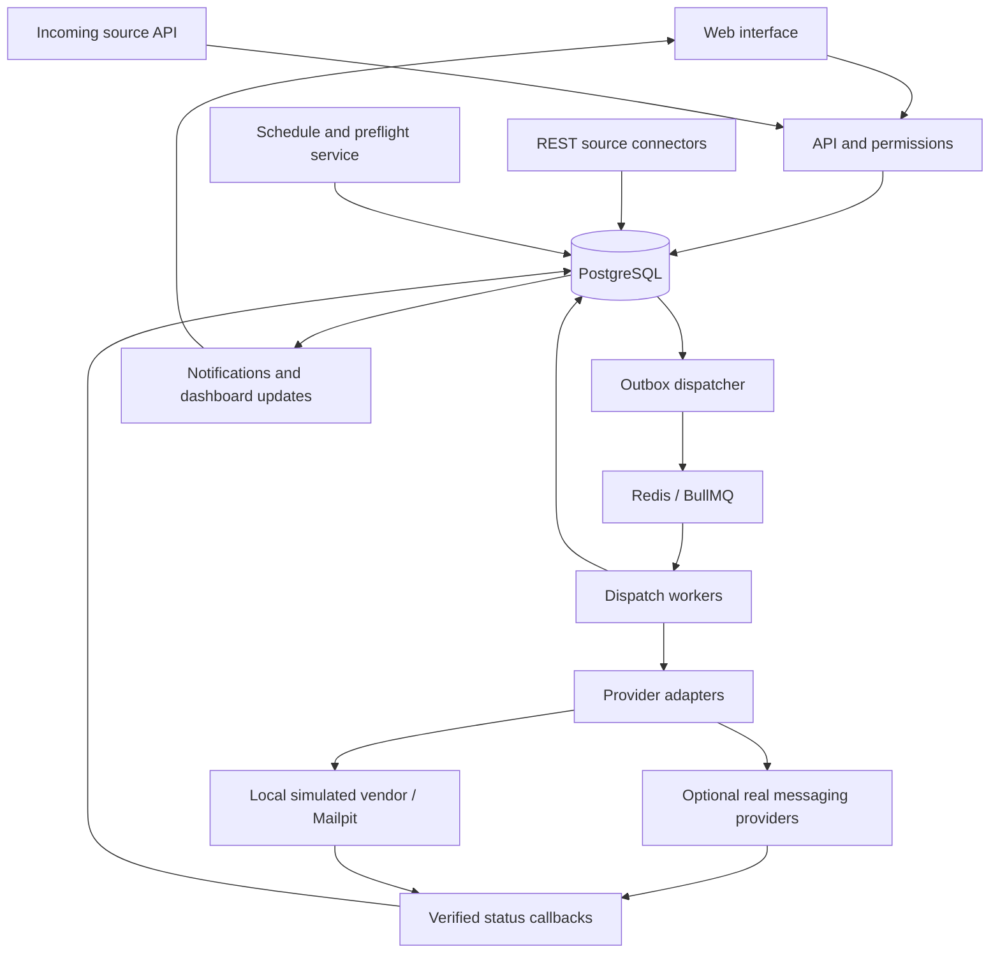

# Project Brief — Multi-Channel Messaging Platform

Version: 0.1  
Date: 2026-10-28  
Status: Planning baseline for review; application implementation has not started  
Working title: Multi-Channel Messaging Platform; final product name is not yet selected  
Primary market: Indonesia  
Initial environment: Local computer; deployable to a server later  
Primary implementation language: TypeScript

## 1. Purpose

Build a portfolio-quality web application for companies and teams to prepare, approve, schedule, send, monitor, and account for outbound messages through configurable third-party providers.

Support email, SMS, and WhatsApp first, with an extensible design for additional channels. A provider may support several channels. Users should work through clear business screens; technical provider configuration belongs in administration.

Combine the approachable campaign experience of marketing platforms, reusable multi-channel workflows, and detailed delivery troubleshooting with company/team permissions, approval control, and cost-centre budgets. These are design references, not a commitment to reproduce every feature of existing products.

## 2. Decision register

### 2.1 Confirmed requirements

| ID | Decision |
| --- | --- |
| DEC-001 | One application supports multiple customer companies. A single-company installation uses the same model with one company. |
| DEC-002 | Use TypeScript. The proposed stack is Next.js/React, NestJS, PostgreSQL, Redis, and BullMQ open source. |
| DEC-003 | Local development, queue processing, and the default demonstration must have no mandatory paid software or SaaS dependency. Real provider traffic is separate from infrastructure cost. |
| DEC-004 | Outbound messaging comes first. Inbound APIs for source data and provider status callbacks are included; a two-way customer conversation inbox is deferred. |
| DEC-005 | Start with email, SMS, and WhatsApp. Prefer Indonesian providers when actual API documentation and access are available. |
| DEC-006 | Support single-recipient and bulk messages, immediate sending, one-time schedules, and recurring schedules. |
| DEC-007 | Immediate and scheduled campaigns require approval. Each company can configure more than one approval level. |
| DEC-008 | A recurring schedule is approved once when created; do not require approval for every normal occurrence. |
| DEC-009 | Data sources include CSV/XLSX uploads, authenticated REST API retrieval, and an incoming API for another system to submit data. Direct database connections come later. |
| DEC-010 | Templates support variables populated from source data, such as a loan reference. |
| DEC-011 | Teams see information within their permitted scope, with configurable functional access levels. Company administrators can see all teams in their own company. |
| DEC-012 | Users can manage their own profile information and picture. |
| DEC-013 | Dashboard layouts and views are customizable within permissions. |
| DEC-014 | Track delivery states, attempts, provider references, and errors. Maintain an audit trail for important activity and changes. |
| DEC-015 | Allocate charges by cost centre. Budget periods can span 1, 3, 6, or 12 months. |
| DEC-016 | Check budget before a run. Notify the responsible team when insufficient, allowing authorized users to increase the budget or stop the campaign. |
| DEC-017 | A campaign ID identifies its schedule; each occurrence also needs its own run ID and delivery records. |
| DEC-018 | Missed schedules after computer/application downtime must be marked missed, with an explicit rescheduling decision. Do not automatically send a backlog. |
| DEC-019 | 10,000 means total outbound messages, not recipients. It is the initial capacity reference, not evidence of unlimited supported volume. The user prefers avoiding a permanent business cap. |
| DEC-020 | Hosting selection and production server sizing are deferred. Build locally now with a deployment path later. |

### 2.2 Recommended implementation defaults

The following resolve routine design details and remain configurable or reviewable. They are recommendations rather than additional user-confirmed business rules.

- Do not hardcode a 10,000-message product limit. Use 10,000 logical outbound messages per run as the initial load-test target, with configurable admission limits, file-size limits, concurrency, and provider pacing.
- Insufficient budget places a run on budget hold and prevents its undispatched messages from sending. Team notifications offer links to budget adjustment or campaign cancellation.
- Budget increases are internal allocations, not a payment gateway transaction.
- A campaign creator cannot approve the same campaign. Seed separate operator and approver accounts for the local demonstration.
- Approval covers a versioned campaign definition. Changes that alter approved content, audience rules, channels, schedule, cost centre, or spending boundaries invalidate approval.
- A budget increase does not automatically replay missed occurrences or send a held run outside its approved execution window.
- Default UI language is Bahasa Indonesia, with English available. Default currency is IDR and default timezone is Asia/Jakarta; these remain company/user settings.
- Dashboards use a defined widget catalog with configurable layouts and filters, rather than arbitrary executable queries.
- Begin with a modular backend and separate worker processes, rather than distributed microservices.

## 3. Scope and exclusions

### 3.1 Included

1. Login, account lifecycle, profiles, companies, teams, configurable roles and permissions.
2. Contacts, source imports, field mapping, validation, previews, and approved data-source connections.
3. Versioned templates with variables, channel-specific content, and provider template references.
4. Campaign creation, multi-level approval, immediate dispatch, one-time schedules, recurrence, pause, cancellation, and missed-run handling.
5. Configurable providers, provider accounts, channel capabilities, rate cards, and integration testing.
6. Durable message dispatch, delivery-event processing, retries, duplicate protection, and investigation of uncertain outcomes.
7. Cost-centre allocation, configurable budget periods, budget holds, internal top-ups, reconciliation, and reports.
8. Customizable dashboards, in-app notifications, optional browser push, audit search, and exports.
9. A complete local demonstration using simulated vendors and captured email.
10. Local configuration and architecture that can later be deployed without rewriting the product.

### 3.2 Deferred

- Two-way customer chat, agent assignment, and a conversation inbox.
- Customer invoicing, paid subscriptions, payment collection, or resale of messaging credits.
- Direct database connections and arbitrary user-supplied SQL.
- AI copywriting, a general-purpose visual workflow builder, and advanced marketing attribution.
- Complex automatic cross-provider or cross-channel failover before its duplicate and charging rules are defined.
- Production infrastructure provisioning, Kubernetes, multi-region operation, and promised delivery-time SLAs.
- A universal zero-code adapter for every possible vendor protocol.
- Production-grade scale claims until measured against specified hardware, traffic, and provider limits.

## 4. Users, companies, teams, and permissions

### 4.1 Isolation model

- Every business record belongs to a company; team ownership is recorded where applicable.
- A single-company deployment has one company, not a separate application architecture.
- A user can have memberships and roles within authorized companies/teams. Each request uses an explicit active company context.
- Membership in one team does not expose another team's campaigns, contacts, content, spending, or exports.
- Cross-team access requires an explicit company-level permission.
- Enforce scope and permission checks on the server, including list queries, detail views, mutations, file downloads, exports, incoming APIs, and dashboard queries.
- Database constraints should prevent associations between records from different companies.

### 4.2 Starting role templates

| Role | Intended responsibility |
| --- | --- |
| Platform Administrator | Manage company provisioning and platform configuration. Cross-company content access is separately controlled and audited. |
| Company Administrator | Manage company settings, teams, memberships, roles, approval policies, and authorized company-wide views. |
| Team Manager | Manage permitted team operations and reporting. |
| Operator / Campaign Creator | Import data, prepare templates/campaigns, submit approval requests, and inspect permitted results. |
| Approver | Act on eligible approval stages within configured scope and limits. |
| Finance / Budget Manager | Manage authorized budgets and adjustments, rate visibility, reconciliation, and financial reports. |
| Viewer | View permitted dashboards and campaign results without operational changes. |

Companies can create roles and assign granular permissions. Role titles or numeric levels alone must not silently grant financial, approval, or cross-team privileges.

Examples of separate permissions: campaign.create, campaign.submit, campaign.approve, campaign.pause, campaign.cancel, campaign.reschedule, template.manage, provider.configure, provider.activate, budget.adjust, audit.view, report.export, and company.view_all_teams.

### 4.3 Account and profile features

- Login/logout, password change/reset, account invitation or administrative creation, and deactivation.
- Profile name, picture, contact details, language, and timezone.
- Profile and company pictures use validated uploads with access controls and safe file handling.
- Server-side authorization remains authoritative even when the UI hides an action.
- Active status and eligibility are rechecked when a user approves or performs another privileged action.

## 5. Core concepts and identifiers

| Concept | Purpose |
| --- | --- |
| Company | Customer organization and primary data boundary |
| Team | Operational ownership and visibility boundary inside a company |
| Cost centre | Internal spending allocation target |
| Provider definition | Reusable integration contract and capabilities |
| Company provider account | A company's credentials, sender configuration, and enabled channels for a provider |
| Data source / Dataset | Source definition or imported version of recipient/personalization data |
| Template version | Content, variables, formatting, and relevant vendor template references |
| Campaign | Business purpose, ownership, content selection, audience rules, cost centre, and schedule |
| Campaign version | The definition reviewed and approved |
| Schedule | One-time or recurring timing rules for a campaign |
| Run | One scheduled occurrence or immediate execution |
| Message | One intended channel delivery to one recipient within a run |
| Attempt | A technical submission attempt to a provider |
| Delivery event | A received or generated update about message state |
| Budget period | Allocation and date range for a cost centre |
| Budget reservation / Ledger entry | Pending allocation or recorded financial movement |
| Audit event | Evidence of a user/system action and relevant changes |

Maintain the relationship:

`Campaign ID → Campaign version → Schedule ID → Run ID → Message ID → Attempt ID`

One recipient receiving SMS and WhatsApp produces two logical outbound messages. A retry creates another attempt, not another logical message, although additional vendor charges may still be possible.

## 6. User experience and screens

### 6.1 Navigation

Ordinary users see a concise menu based on their permissions:

- Dashboard
- Create campaign
- Campaigns and schedules
- Approvals, when eligible
- Contacts and data sources
- Templates
- Delivery history
- Budgets and spending, when eligible
- Notifications
- My profile

Company/platform administration exposes the applicable configuration screens separately.

### 6.2 Campaign wizard

1. Enter campaign name, purpose, team, and cost centre.
2. Choose or upload recipients/data and map fields.
3. Choose channel(s), sender, template, and permitted provider/routing settings.
4. Preview actual rendered samples and resolve validation issues.
5. Select immediate, one-time, or recurring execution.
6. Review recipients, logical message count, estimated cost, available budget, schedule/timezone, and approval path.
7. Submit for approval.

The main action should say what happens, for example, "Submit for approval" rather than suggesting that an unapproved campaign will send immediately.

### 6.3 UX requirements

- Plain Bahasa Indonesia labels with English language support.
- Human-readable status labels and explanations; do not rely on color alone.
- Useful empty states, visible validation, and recovery steps.
- Preview for each selected channel.
- Show excluded/invalid rows and reasons before submission; do not silently send only part of an approved audience.
- Confirmation for cancellation, rescheduling, budget changes, and destructive administration.
- Desktop-first responsive design with usable tablet/mobile views.
- Accessible keyboard navigation, focus states, contrast, and clear forms.
- Technical request/response details are available to authorized troubleshooting users, not forced on ordinary campaign creators.

### 6.4 Customizable dashboard

- Move, resize, show, and hide supported widgets.
- Save personal layouts and filters; restore company/role defaults.
- Company administrators can publish default layouts.
- Widget catalog: pending approvals, upcoming runs, delivery counts by state, failures, delivery trends, vendor/channel performance, budget available/reserved/spent, and missed/held runs.
- Each widget uses the same company/team/financial visibility rules as other screens.
- Custom layouts never expand access to underlying data.
- Present simulated results and charges with a persistent demo indicator.

## 7. Templates and source data

### 7.1 Template variables

Use a consistent initial syntax such as:

```text
Hello {{customer_name}}, your reference is {{loan_no}}.
Your appointment is on {{appointment_date}}.
```

The loan reference is only an example variable; the application is a general messaging product.

Requirements:

- Define required/optional variables, expected types, permitted defaults, and simple formatting rules.
- Map uploaded columns or API fields to variables.
- Validate required values before approval/dispatch as appropriate.
- Show previews using actual sampled rows and clearly marked dummy samples.
- Escape user data correctly in email HTML and other output contexts.
- Avoid arbitrary executable expressions in templates.
- Version templates and retain the rendered-content/data reference needed to investigate a run.
- Editing a shared template creates a new version; previously approved campaigns do not silently change.
- Track WhatsApp provider template ID/name, language, parameter mapping, and approval status separately from the local template's draft/published state.
- Do not assume a locally saved WhatsApp template is approved for real delivery.

### 7.2 Uploaded data

- CSV and XLSX import with column mapping, progress, validation report, and preview.
- Normalize Indonesian phone numbers using an explicit country policy; flag ambiguous numbers.
- Validate email addresses and required destination fields.
- Detect duplicates using the configured campaign/channel recipient policy.
- Set configurable file-size and row-processing safeguards.
- Process large imports in the background and stream/chunk where feasible.
- Keep dataset versions and ownership; files and rows cannot be accessed across unauthorized companies/teams.
- Validate spreadsheet/file content and handle exports without creating spreadsheet-formula execution hazards.

### 7.3 REST retrieval and incoming API

- Register authenticated REST source connections with endpoint, allowed parameters, field mapping, pagination, timeout, and ownership.
- Support manual refresh and authorized scheduled retrieval.
- Provide a company-scoped incoming API for another system to submit datasets/records.
- Incoming data is validated and deduplicated; receiving it does not bypass campaign approval.
- Use idempotency keys for retried imports/submissions.
- Keep credentials server-side, encrypted or referenced through environment/secret configuration, and out of logs.
- Restrict configurable network targets and redirects; a connector must not become unrestricted access to host-local or infrastructure endpoints.
- Add direct database sources in a later phase after access, query, isolation, and credential rules are specified.

### 7.4 Audience and content snapshots

- For immediate and one-time campaigns, freeze the approved audience/content snapshot by default.
- For recurring campaigns, approve the source definition, filter rules, template version, channels, and spending boundaries once.
- Each recurring run retrieves or selects its current data under those approved rules and creates its own validated snapshot.
- A new source, widened filter, changed template, or changed channel requires campaign reapproval.
- If a recurring snapshot violates approved limits, hold that run for action; do not silently truncate or widen approval.
- No approval is required for every normal occurrence when the approved definition remains unchanged.

## 8. Approval workflow

### 8.1 Company configuration

- Configure sequential approval levels, with more than one level supported.
- Each level specifies eligible roles/users and the relevant team/company scope.
- Initial completion rule: one eligible approver completes a level. Support for requiring several approvals within the same level is an extension unless selected during implementation planning.
- Policies can select a route by campaign type, channel, amount, or team where configured.
- Snapshot the policy version and approver conditions when submitted.
- Revalidate the actor's active membership and eligibility when approving.

### 8.2 Behaviour

- Both immediate sending and activating a schedule require final approval.
- A recurring series is approved once; ordinary occurrences do not generate repeated approval requests.
- Prevent a creator from approving their own campaign.
- Actions: approve, reject with reason, or return for revision.
- Revisions create a new campaign version and invalidate the previous approval for the changed definition.
- The final approval of an immediate campaign makes it eligible to run; normal preflight and budget checks still apply.
- The final approval of a schedule activates future eligible occurrences.
- If the intended first scheduled occurrence is already overdue, mark it missed and require an explicit timing decision.
- Notifications link eligible approvers to the appropriate request.
- Every decision records actor, stage, reason where applicable, timestamps, and the approved version.

## 9. Scheduling and run lifecycle

### 9.1 Schedule configuration

Per campaign, support:

- Immediate execution after final approval.
- A one-time date and time.
- Recurring schedules with daily/weekly/monthly options, interval, start, optional end date or occurrence count, and timezone.
- An advanced cron expression only if needed; the default UI should use understandable controls.
- Pause, resume, cancel, and explicit rescheduling subject to permissions.
- An explicit rule for monthly dates that do not occur in every month; recommended default is to skip that occurrence rather than silently move it.
- Store UTC timestamps alongside the IANA timezone needed to interpret the user's schedule.

### 9.2 Run generation

- Store schedule definitions and run records in PostgreSQL.
- Use a unique occurrence key based on schedule/version and intended execution time.
- Ensure two scheduler processes cannot create duplicate runs for the same occurrence.
- Use the queue for dispatch, not as the only record of what a campaign was supposed to do.
- Separate readiness, approval, source validation, budget eligibility, and worker execution.

Suggested run states:

`PLANNED → PREFLIGHT → QUEUED → RUNNING → COMPLETED / COMPLETED_WITH_ERRORS`

Additional states: `BUDGET_HOLD`, `VALIDATION_HOLD`, `MISSED`, `PAUSED`, `CANCELLED`, and `FAILED`.

### 9.3 Downtime and late execution

- Persist intended occurrence times and use a configurable lateness/grace policy.
- When the machine/application was unavailable and an occurrence's execution window expired without starting, mark it MISSED.
- Do not let queue restart behaviour automatically replay missed occurrences.
- Provide explicit reschedule/skip actions with an audit record.
- An already-running batch interrupted by downtime is a recovery case, not a brand-new scheduled occurrence. Preserve completed/uncertain messages and require the configured recovery decision for the remaining work.
- Pausing or cancelling prevents further dispatch where possible. Already submitted messages cannot be assumed recalled.
- The computer and required services must be running for local scheduled execution; offline delivery cannot be promised.

## 10. Providers, channels, and low-code integration

### 10.1 Model

Separate:

1. Provider definitions/adapters.
2. Channels supported by that provider.
3. Each company's provider account and credentials.
4. Sender identities and vendor template references.
5. Rate cards and routing assignments.

A provider may have several channels; a company may have several accounts or sender identities.

### 10.2 Configuration interface

For supported generic HTTP integrations, an authorized administrator can configure:

- Base endpoint and allowed destinations.
- Supported authentication method.
- Request headers and field mapping.
- Destination, content, template, parameter, and media fields within supported capabilities.
- Response message-ID extraction and acceptance/error mapping.
- Status-callback verification and event-field mapping.
- Provider/account rate limits, timeout, and retry classification.
- Channel capabilities, sender requirements, rate cards, and effective dates.
- Test mode, connection test, validation, version publication, activation, and disablement.

Configuration changes are versioned and audited. Queued/running messages must have a defined configuration-version policy rather than silently changing integration semantics mid-run.

### 10.3 Limits of low code

- Standard integrations within the supported contract should be configurable without application redeployment.
- Unusual authentication, media workflows, signatures, or proprietary protocols can require a tested adapter and normal deployment.
- Adding a future channel is configuration-only only when its capabilities fit an existing generic channel contract. New semantics may require UI and adapter work.
- Do not allow arbitrary administrator-provided code execution as a shortcut to universal integration.
- No real Indonesian vendor adapter should be labelled complete without actual documentation, credentials/test access, and exercised requests/callbacks.
- Global provider definitions may be reusable; company credentials, sender accounts, and negotiated rates remain scoped to the owning company.

## 11. Delivery tracking and reliability

### 11.1 Message state

| State | Meaning |
| --- | --- |
| CREATED | Logical message exists but dispatch has not started |
| QUEUED | Eligible for worker processing |
| SENDING | Submission attempt is in progress |
| ACCEPTED | Provider acknowledged the submission |
| SENT | Provider reports the message has left its sending stage, where supported |
| DELIVERED | Delivery confirmation received |
| READ / OPENED | Optional channel-specific engagement signal; not universally supported or proof of human reading |
| FAILED | A known terminal submission/delivery failure |
| SUPPRESSED / SKIPPED | Intentionally not sent, with a reason |
| CANCELLED | Undispatched work was cancelled |
| UNKNOWN | Submission/delivery outcome needs reconciliation or review |

Do not force every provider into every state. Store normalized states and original provider codes/events. Do not mark messages delivered merely because the HTTP request succeeded. Email delivery to a receiving server does not prove inbox placement or human reading.

### 11.2 Timeline and investigations

For each message, show:

- Campaign, version, run, recipient reference, channel, sender, provider account, and provider message ID.
- Template version and permitted rendered preview.
- Attempts, timestamps, status transitions, normalized error, and redacted diagnostic details.
- Budget reservation and charge references visible to authorized roles.
- Retry/reconcile actions and their eligibility.

### 11.3 Reliable dispatch

- Write business records and an outbox entry in one PostgreSQL transaction; an outbox dispatcher publishes work to BullMQ.
- Outbox and job consumers must tolerate repeated processing.
- Use stable logical-message and attempt identifiers; pass a provider idempotency key when supported.
- Queue jobs contain references and minimal required data rather than complete datasets or credentials.
- Process imports and sends in bounded chunks with configurable global/company/provider/account concurrency and pacing.
- Retry only failures classified as retryable, with bounded attempts and backoff.
- A network timeout may occur after provider acceptance. Reconcile using provider references/idempotency/status queries when available; do not blindly resend or switch vendors.
- Exactly-once external delivery cannot be promised for providers without the necessary support.
- Deduplicate delivery callbacks and handle out-of-order events without regressing a known delivery state.
- Validate provider callbacks using the configured verification mechanism.
- Preserve failed/uncertain records for investigation independently of queue-history retention.
- Expose queue depth, oldest-job age, throughput, retries, and failures to authorized administrators.

## 12. Cost centres, rate cards, and budgets

### 12.1 Rate cards

- Company/provider/channel rates with currency, applicable conditions, effective dates, and version.
- Support provider-specific billable units, including possible segmentation or category differences; do not assume one API call equals one billable unit.
- Store the price basis used for estimates and actual charges.
- Preserve historical rates and costs when a rate changes.
- A newly effective rate must still respect the approved campaign spending boundary before dispatch.

### 12.2 Budget periods

- A cost centre has explicit dated budget periods lasting 1, 3, 6, or 12 calendar months.
- Specify start date, exclusive end date, timezone, original allocation, and adjustments.
- Reject ambiguous overlapping active periods for the same applicable budget scope.
- Period duration is not forced to a calendar quarter/year; it follows the configured start date.
- Start a new period explicitly according to company configuration.
- No automatic carry-forward unless the company selects a defined policy.

Track allocated, adjusted, reserved, confirmed spent, and available amounts using exact decimal/fixed-point arithmetic.

### 12.3 Preflight and insufficient budget

Before each immediate or scheduled run:

1. Validate approval/version, data, recipients, enabled provider configuration, schedule window, and campaign state.
2. Estimate the run's charges under the applicable rate rules.
3. Check the approved campaign ceiling and applicable cost-centre budget.
4. Atomically reserve the required allowance so concurrent runs cannot use the same balance.
5. Dispatch eligible work only after the reservation succeeds.

If insufficient:

- Place the run on BUDGET_HOLD and stop its undispatched work.
- Notify the creator/responsible team and configured budget managers.
- Explain required allowance, currently available allowance, cost centre, campaign/run IDs, and relevant deadline.
- Offer authorized actions to request/increase the allocation, cancel the run, or pause/cancel the recurring campaign.
- Deduplicate reminders and track acknowledgement/action.
- A top-up is an audited internal budget adjustment with amount, reason, and actor.
- Resume requires a fresh preflight. If the execution window has expired, require explicit rescheduling; no backlog replay.

Budget enforcement limits new commitments according to known rates/reservations. Unexpected final vendor charges can create a reconciliation variance; do not claim absolute final-spend protection without a provider-supported charge ceiling.

### 12.4 Reconciliation and reporting

- Maintain separate reservations, confirmed charges, releases, and adjustments in an append-oriented ledger.
- Prevent duplicate callbacks/reconciliation jobs from double-charging or double-releasing a reservation.
- Do not assume a failed message is unbillable.
- Reconcile pending/actual charges from provider evidence when available.
- Use a distinct demo ledger or explicit simulation classification for simulated charges.
- Reports by company, team, cost centre, period, campaign/run, channel, provider, and status.
- Distinguish estimates, reservations, actual charges, and unresolved variances.
- Exports follow data-access permissions and are audited.

## 13. Notifications and audit trails

### 13.1 Notifications

Required initial in-app notification events:

- Approval submitted, approved, rejected, or returned.
- Budget warning/hold and budget-adjustment outcome.
- Missed occurrence.
- Significant run failure or provider configuration problem.
- Campaign/run completion.

Notification recipients follow company/team ownership and eligibility. Optional browser push may be enabled by each user; it requires appropriate browser permission and delivery capability. The application must continue to show in-app notifications if push is unavailable or denied.

The local demonstration must not depend on a paid push/email/SMS notification service. External-provider callbacks need a reachable test endpoint when exercised; localhost-only simulation does not require public exposure.

### 13.2 Audit coverage

Record significant actions involving:

- Login/logout, denied privileged operations, and account/permission administration.
- Campaign, audience/source rules, templates, schedules, approval routes, and approval decisions.
- Pause, cancellation, recovery, and rescheduling.
- Provider credentials/configuration changes, activation, sender and rate changes.
- Budget allocations/adjustments, reservations, charge reconciliation, and financial exports.
- Import operations, source executions, and significant integration errors.
- Administrative dashboard-default changes and sensitive data access where configured.

Fields include event ID, timestamp, actor or system identity, company/team, action, resource type/ID/version, related campaign/run/message IDs, request correlation, IP/session context where available, reason, and redacted before/after values.

Audit writes are append-only through ordinary application interfaces. This is not a claim that database administrators cannot alter storage. Restrict audit access and define retention/export controls. Never store passwords, access tokens, or full unredacted credential changes in audit payloads.

## 14. Proposed technical architecture

### 14.1 Stack

| Layer | Proposed implementation |
| --- | --- |
| Frontend | Next.js / React / TypeScript |
| API and business logic | NestJS / TypeScript |
| Primary database | PostgreSQL |
| Job queue | BullMQ open-source edition |
| Queue persistence/service | Self-hosted Redis under an appropriate license |
| File storage | Local filesystem through a storage interface; object-storage implementation can be added for deployment |
| Local email testing | Mailpit |
| Vendor simulation | Local deterministic provider simulator with status callbacks and failures |
| Live UI updates | Server-sent events or an equivalent lightweight mechanism selected during implementation |
| Authentication | Maintained free libraries and server-controlled permissions; no required paid identity service |
| Browser push | Optional standards-based implementation without a mandatory paid SaaS dependency |

Select maintained compatible versions and record their licenses during implementation. Do not introduce BullMQ Pro or a paid cloud plan as an unnoticed dependency.

### 14.2 Components



This diagram describes a proposed design, not an existing deployed system.

### 14.3 Local and later deployment

- Keep web/API, scheduler, dispatcher, and workers as independently runnable processes from one repository.
- Use persistent development data directories/volumes and documented startup/shutdown steps.
- Keep environment-specific URLs, credentials, concurrency, and storage paths in configuration.
- A container workflow may be provided, but must not require a paid desktop-container license for the intended development setup.
- Include health/readiness checks, migrations, configuration validation, and backup/restore instructions.
- Before external deployment, decide HTTPS/domain, hosting resources, database/Redis persistence, secret management, storage, monitoring, and webhook reachability.
- Production hosting and external delivery may incur costs even though the application software is self-hostable.

## 15. Capacity and resource policy

- No hardcoded campaign maximum in the business model.
- Initial benchmark: a run containing 10,000 logical outbound messages.
- Administrators can configure technical admission limits based on tested resources.
- Keep limits on import size, pending work, simultaneous runs, worker concurrency, retries, and provider pacing.
- Large accepted campaigns are processed in chunks; no giant HTTP request or unbounded Promise.all operation sends an entire audience.
- Show estimated volume and processing implications before approval.
- Hold/reject work that exceeds configured technical safeguards with a clear explanation; never silently drop recipients/messages.
- Per-provider throughput and recipient-provider behaviour determine actual delivery duration.
- Measure beyond 10,000 before presenting a higher supported capacity.
- Record OS, CPU, RAM, service versions, data/message sizes, concurrency, throughput, latency, errors, and restart behaviour with benchmark results.
- Current execution environment is macOS on arm64. Exact CPU model/RAM and the future server specification are not confirmed; do not invent a server-sizing guarantee.

## 16. Conceptual data entities

Group persistence by module; final tables and indexes are chosen during implementation.

- Identity: users, companies, teams, memberships, roles, permissions, role assignments, sessions, user profiles.
- Configuration: provider definitions/versions, company provider accounts, channel capabilities, sender identities, rate cards/versions.
- Content and data: templates/versions/variables, source connections, datasets/versions, source executions, import errors, recipient records.
- Campaigns: campaigns/versions, schedules, campaign runs, approved audience/source snapshots.
- Approvals: policy versions, requests, stages/tasks, decisions.
- Delivery: messages, attempts, normalized delivery events, callback deduplication, outbox.
- Accounting: cost centres, budget periods, adjustments, reservations, charge ledger entries, reconciliation cases.
- Experience: notifications, push subscriptions if enabled, dashboard layouts and company defaults.
- Evidence: audit events and permitted export records.

Preserve identifiers and foreign-key relationships across approval, dispatch, accounting, and audit. Avoid using mutable provider labels or campaign names as identifiers.

## 17. API and integration boundaries

The final OpenAPI contract should cover:

| Area | Representative operations |
| --- | --- |
| Authentication/profile | Login, logout, password/account lifecycle, own profile and picture |
| Company/team administration | Memberships, role definitions, permission assignments |
| Sources/imports | Upload, validate, map, preview, refresh REST source, submit external datasets |
| Templates | Draft, preview with data, version, publish, provider-template mapping |
| Campaigns | Create draft, validate, submit approval, inspect versions |
| Approval | List eligible tasks, approve, reject, return |
| Schedules/runs | Configure recurrence, inspect runs, pause, resume, cancel, explicitly reschedule missed work |
| Delivery | List scoped messages, timeline, permitted diagnostics/reconciliation |
| Providers | Configure/test/version/activate provider accounts and rate cards |
| Budgets | Periods, balances, requests/adjustments, holds, reconciliation, reports |
| Notifications/dashboard | Inbox/read state, optional push subscription, saved layouts/filters |
| Audit/exports | Scoped queries and controlled export |
| Provider callbacks | Verify, deduplicate, normalize, persist events |

Use pagination/filtering for large lists, versioned validation contracts, correlation IDs, and idempotency where operations can be retried. API clients must not obtain a direct sending path that skips approval or budget checks.

## 18. Local portfolio demonstration

The default demo must run without paid provider credentials.

Seed synthetic examples for:

- At least two isolated companies, several teams, and distinct cost centres.
- Separate creator, multi-level approver, finance, company-admin, and viewer accounts.
- One provider definition supporting several simulated channels.
- CSV/XLSX datasets and a local REST source containing template variables.
- Immediate, one-time, and recurring campaigns.
- Successful delivery, known failure, delayed callback, duplicated/out-of-order callback, timeout with uncertain acceptance, and retry-safe failure.
- An insufficient-budget run followed by an authorized budget increase.
- A missed schedule and explicit rescheduling.
- Personal dashboard customization.
- A repeatable 10,000-message simulation scenario.

Use predictable simulator behaviours so tests can exercise real queue, approval, accounting, and callback code. A simulated vendor is not a bypass that directly marks all messages delivered. Label demo data/results and prevent accidental routing to real destinations.

Optional real tests can use an available WhatsApp developer test account or an Indonesian vendor sandbox after access is verified. Do not promise free real bulk SMS/WhatsApp delivery or claim an untested provider is integrated.

## 19. Acceptance criteria

| ID | Observable result |
| --- | --- |
| AC-001 | A user cannot list, view, modify, download, or export another company's business records by changing an identifier or filter. |
| AC-002 | Team users see only authorized team information; company administrators can view their company's teams without automatic cross-company access. |
| AC-003 | Configured functional permissions control actions on the API as well as in the UI. |
| AC-004 | A user can update permitted profile fields and a validated picture. |
| AC-005 | A creator imports CSV/XLSX, maps variables, and sees errors/duplicates and rendered samples before submission. |
| AC-006 | REST retrieval and incoming source submissions create correctly scoped versioned data without bypassing approval. |
| AC-007 | A provider can support multiple channels and separate company accounts/rates. |
| AC-008 | A compatible generic vendor can be configured/tested/activated through administration; unsupported contracts clearly require an adapter. |
| AC-009 | Template changes create a new version and do not alter previously approved content. |
| AC-010 | An immediate campaign cannot dispatch before its final required approval. |
| AC-011 | A company can configure at least two sequential approval levels; creator self-approval is rejected. |
| AC-012 | A recurring series runs under its once-approved definition without approval on every ordinary occurrence. |
| AC-013 | Material changes to an approved definition require reapproval; dynamic data cannot silently widen approved source rules or spending boundaries. |
| AC-014 | Concurrent scheduler instances create no duplicate run for the same schedule occurrence. |
| AC-015 | One-time/recurring times are interpreted in the selected timezone and linked to the campaign ID and distinct run IDs. |
| AC-016 | An expired occurrence after downtime becomes missed and does not auto-send on restart. |
| AC-017 | A missed run can be explicitly rescheduled with preserved history and a new execution identity. |
| AC-018 | Budget periods support 1/3/6/12 months with unambiguous date boundaries. |
| AC-019 | Competing runs cannot reserve the same available cost-centre budget. |
| AC-020 | An insufficient-budget run sends no further undispatched messages and produces a scoped notification with actionable links. |
| AC-021 | An authorized budget increase is audited; a held run must pass preflight again and cannot replay expired work automatically. |
| AC-022 | Retry/callback repetition does not create duplicate ledger movements or duplicate logical messages. |
| AC-023 | Accepted/sent/delivered/unknown remain distinguishable; callbacks do not regress a delivered message to an earlier state. |
| AC-024 | Uncertain provider acceptance does not trigger an uncontrolled duplicate resend. |
| AC-025 | A message timeline joins campaign/run, template, attempts, provider IDs, status events, and permitted cost information. |
| AC-026 | Pause/cancel prevents new dispatch where possible while retaining already submitted messages and their charges/results. |
| AC-027 | Personal dashboard layouts persist and cannot expose data outside the user's permissions. |
| AC-028 | Significant administrative, approval, schedule, and financial actions have searchable, redacted audit evidence. |
| AC-029 | The default demo exercises email/SMS/WhatsApp flows locally without paid credentials and labels simulated results. |
| AC-030 | A documented 10,000-message simulation completes or exposes a diagnosable bounded failure without unbounded resource use; results include the actual environment and measurements. |
| AC-031 | Restart/retry exercises preserve durable campaign/message evidence and do not silently lose or replay work. |
| AC-032 | No completed feature is described as provider-tested, load-tested, or production-ready without the corresponding evidence. |

## 20. Suggested implementation phases

| Phase | Deliverable | Exit evidence |
| --- | --- | --- |
| 1. Foundation | Repository, configuration, local PostgreSQL/Redis, authentication, companies/teams/permissions, profiles | Local startup and isolation/authorization checks |
| 2. Content and data | Templates, imports, variable mapping, previews, local REST source, incoming data API | Valid and invalid datasets exercised end to end |
| 3. Approval and budgets | Company approval levels, campaign versioning, cost centres, period budgets, reservations, alerts | Unapproved sending blocked; budget races and hold/top-up paths checked |
| 4. Dispatch and tracking | Outbox, BullMQ workers, simulated multi-channel vendor, Mailpit, callback timeline | Retry, duplicate/out-of-order callback, and uncertain-outcome cases |
| 5. Scheduling | Immediate/one-time/recurring runs, once-per-series approval, missed/recovery controls | Recurrence, restart, expired approval timing, and missed-run scenarios |
| 6. UX and visibility | Custom dashboards, notifications, optional push, reports and audit search | Role-based usability walkthroughs and evidence of permitted views |
| 7. Extensibility and portfolio | Configurable generic connector, source/rate versioning, demo data, benchmark and documentation | Fresh-machine setup, reproducible 10,000-message trial, clear feature status |
| 8. Optional real integrations | Actual Indonesian/vendor test integration and deployment preparation | Documented requests/callbacks with verified access; deployment choices recorded |

Deliver working slices within phases rather than generating every screen before the underlying controls function. Keep the brief updated when an agreed decision changes.

## 21. Remaining items that do not block this brief

- Final product/repository name.
- Exact local CPU/RAM and desired simultaneous campaigns.
- Initial real vendor choice, API documentation, account access, and available sandbox conditions.
- Exact retry counts, timeouts, execution grace periods, and resource admission defaults after local testing.
- Final approval-routing conditions and whether any level needs several independent approvals.
- Audit/content/file retention and backup policy before using real customer information.
- Company budget-notification recipients and optional warning thresholds.
- Hosting, domain, external callback endpoint, and production sizing.

Do not substitute invented answers. Use the confirmed decisions and recommended defaults above for planning, and record implementation-specific choices explicitly when they are made.

## 22. Reference documentation

These links support technology and testing choices. Their features/terms must be rechecked when selecting implementation versions or a real provider.

- [NestJS queues](https://docs.nestjs.com/techniques/queues): BullMQ integration and background processing.
- [BullMQ MIT license](https://github.com/taskforcesh/bullmq/blob/master/LICENSE): open-source edition licensing.
- [BullMQ job schedulers](https://docs.bullmq.io/guide/job-schedulers): queue scheduling facilities; application missed-run policy must still be enforced.
- [BullMQ production guidance](https://docs.bullmq.io/guide/going-to-production): persistence and operational considerations.
- [BullMQ retry guidance](https://docs.bullmq.io/guide/retrying-failing-jobs): attempts and backoff.
- [Redis licensing](https://redis.io/legal/licenses/): self-hosted software licensing versus commercial offerings.
- [Mailpit](https://mailpit.axllent.org/): local email capture and testing.
- [WhatsApp developer resources](https://whatsappbusiness.com/developers/developer-hub/): optional test-number/sandbox resources, not a promise of free real bulk delivery.
- [Twilio delivery status reference](https://www.twilio.com/docs/messaging/guides/outbound-message-status-in-status-callbacks): an example of provider-specific delivery events, not a required provider.
- [Novu](https://github.com/novuhq/novu), [Courier logs](https://www.courier.com/docs/monitor/logs), and [Brevo overview](https://help.brevo.com/hc/en-us/articles/33456241984914-Overview-of-the-Brevo-platform): product/workflow references.
